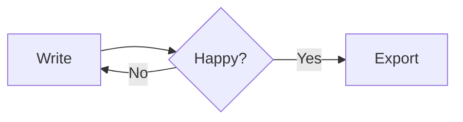

# Welcome to Barkdown

Barkdown is a **seamless** Markdown editor: what you type is rendered *as you write*. Move the cursor into any styled text and its Markdown syntax appears so you can edit it — move away and it disappears again.

[toc]

## Writing

Use the **Paragraph** and **Format** menus, or just type Markdown:

- `**strong**` → **strong**, `*emphasis*` → *emphasis*, `~~strike~~` → ~~strike~~
- `` `code` `` → `code`, `==highlight==` → ==highlight==, `<u>underline</u>` → <u>underline</u>
- `H~2~O` → H~2~O and `x^2^` → x^2^
- Emoji shortcodes like `:sparkles:` → :sparkles: (type `:` and two letters for suggestions)
- Links: [Typora-style links](https://typora.io) — hold ⌘ and click to open

> Blockquotes look like this.
> They can span several lines.

### Lists

1. Ordered lists
2. Keep numbering as you press Return
   - Nested bullets with Tab
   - …and ⇧Tab to outdent

- [x] Task lists are clickable
- [ ] Click a checkbox to toggle it

## Tables

Tables are edited as a grid. Click a cell to type; use Tab, Return and the arrow keys to move around, and the toolbar above the table to add or remove rows and columns or change alignment.

| Shortcut | Action         | Menu      |
| :------- | :------------- | :-------: |
| ⌘B       | Strong         | Format    |
| ⌘1 … ⌘6  | Headings       | Paragraph |
| ⌥⌘T      | Insert table   | Paragraph |
| ⌘/       | Source mode    | View      |

## Code

```swift
struct Greeting {
    let name: String
    func say() -> String { "Hello, \(name)!" }
}
```

```js
const sum = (xs) => xs.reduce((a, b) => a + b, 0)
```

## Math

Inline math like $e^{i\pi} + 1 = 0$ renders in place. Display math gets its own block:

$$
\int_{-\infty}^{\infty} e^{-x^2}\,dx = \sqrt{\pi}
$$

## Diagrams



## Images

Paste or drag images straight into the document. They're copied next to your file (see **Settings → Images**).

## Footnotes

Footnotes keep asides out of the way.[^1]

[^1]: Like this one. ⌥-click a footnote reference to jump to it.

---

## Modes

| Mode | Shortcut | What it does |
| ---- | -------- | ------------ |
| Source Code | ⌘/ | Edit raw Markdown |
| Focus | F8 | Dims everything except the current block |
| Typewriter | F9 | Keeps the current line centered |

## Files

- **Open Folder…** shows a folder in the sidebar as a tree or a list of articles.
- **Quick Open** (⇧⌘O) finds any file in that folder.
- **Search in Folder** (⇧⌘F) searches every document in it.
- **Export** to PDF, HTML, Word, OpenDocument, RTF, PNG — and LaTeX, EPUB and more when [Pandoc](https://pandoc.org) is installed.
- **Themes** change the look; drop your own CSS into the theme folder.
